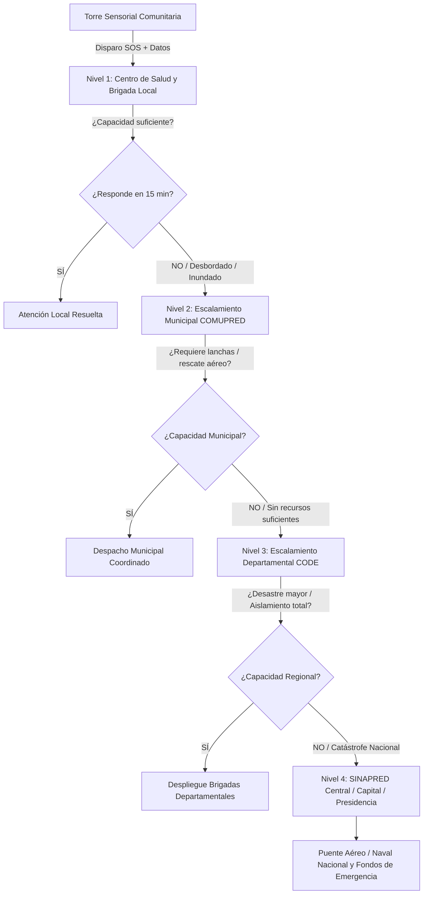

# Sistema Nodal Autónomo de Detección, Gestión de Rescate y Escalamiento Jerárquico Post-Desastre (RESILIX-LATAM)

**Desafío Oficial:** Desafío 9 — Optimización y priorización de recursos y esfuerzos en la post-emergencia  
**Ámbito de Aplicación:** Zonas vulnerables de Latinoamérica (costas, riberas y comunidades aisladas)  
**Disciplina:** Ingeniería en Computación / Sistemas Distribuidos / Cloud & Edge IoT  

---

## 1. Resumen Ejecutivo y Visión

El proyecto propone una **red de torres sensoriales autónomas conectadas a una plataforma cloud distribuida por nodos**, diseñada para operar de forma continua en las tres fases del ciclo del desastre (**Pre, Durante y Post-Emergencia**). 

Al detectar una catástrofe o anomalía extrema, la torre genera un **Paquete de Telemetría Crítica SOS** (mapa de calor de sobrevivientes, estimación de personas atrapadas, nivel de agua/marea y estado de servicios vitales). Este paquete se despacha de inmediato a los actores esenciales (Hospitales, Centros de Salud, Centros de Operaciones de Emergencia —CODE— y Plantas de Bombeo de Agua Potable). 

Si la capacidad de respuesta local se encuentra colapsada, destruida o desbordada, el sistema activa un **Algoritmo de Escalamiento Jerárquico Automático** que eleva la solicitud en cascada del nivel **Comunitario ➔ Municipal ➔ Departamental ➔ Capital/Nacional**, garantizando que la ayuda llegue sin vacíos de comunicación.

---

## 2. El Ciclo Integral de Monitoreo (Pre, Durante y Post)

```
       PRE-EMERGENCIA                      DURANTE EL IMPACTO                     POST-EMERGENCIA
 ┌─────────────────────────┐           ┌────────────────────────┐           ┌────────────────────────┐
 │ • Nivel de marea / río  │           │ • Monitoreo de anegado │           │ • Mapa de calor (FLIR) │
 │ • Presión barométrica   │   ─────>  │ • Resistencia de torre │   ─────>  │ • Conteo de víctimas   │
 │ • Velocidad del viento  │           │ • Registro de colapsos │           │ • Estado de bombeo     │
 │ • Alerta temprana       │           │ • Transmisión satélite │           │ • Disparo SOS + Triage │
 └─────────────────────────┘           └────────────────────────┘           └────────────────────────┘
```

1. **Fase Pre-Emergencia (Prevención Activa):**
   - Sensores ultrasónicos e hidrostáticos miden en tiempo real el ascenso de mareas o caudales de ríos.
   - La estación meteorológica detecta caídas abruptas de presión barométrica (huracanes) y velocidades críticas de viento.
   - Emite avisos tempranos a la población y a los comités locales de prevención para evacuación preventiva.

2. **Fase Durante la Emergencia (Supervivencia y Registro Ciego):**
   - La torre, construida bajo grado de protección IP67 y alimentada por energía solar con baterías LiFePO4, mantiene su operatividad aunque la red eléctrica y celular comercial colapsen.
   - Registra el avance de la inundación y almacena los datos de impacto en su servidor de borde (*Edge Storage*).

3. **Fase Post-Emergencia (Rescate Inmediato y Telemetría de Supervivencia):**
   - Inicia el barrido térmico perimetral de $360^\circ$ con cámaras LWIR para identificar firmas de calor corporal humano (36°C - 37.5°C).
   - Sensores de presencia mmWave confirman vida en estructuras cubiertas por escombros o follaje.
   - Estructuración del paquete de datos SOS y envío instantáneo al servidor central y actores de auxilio.

---

## 3. El Paquete de Telemetría SOS (Datos que Envía la Torre)

La torre no envía simples textos; emite una estructura de datos estandarizada (formato JSON/CAP comprimido) con métricas accionables:

```json
{
  "node_id": "TORRE-CARIBE-04",
  "community": "Haulover / Prinzapolka",
  "timestamp": "2026-10-16T14:02:10Z",
  "status": "POST_DISASTER_CRITICAL",
  "metrics": {
    "water_level_meters": 2.45,
    "flood_trend": "RECEDING",
    "thermal_human_count": 18,
    "estimated_trapped_persons": 6,
    "critical_infrastructure": {
      "water_pump_station": "FLOODED_INOPERATIVE",
      "local_health_post": "ROOF_COLLAPSED",
      "main_dock_pier": "ACCESSIBLE_FOR_BOATS"
    }
  },
  "calculated_priority": "LEVEL_1_EXTREME",
  "thermal_heatmap_uri": "s3://resilix-latam/heatmaps/tc04_20261016.png"
}
```

---

## 4. Matriz de Distribución Multiactor (Nodos Sectoriales)

Al llegar la alerta a la nube, el sistema despacha la información en paralelo según el tipo de institución:

| Actor Destinatario | Información Específica que Recibe | Acción Operativa Inmediata |
| :--- | :--- | :--- |
| **Hospitales y Centros de Salud** | Estimación de víctimas térmicas, gravedad de anegamiento y accesibilidad. | Alistamiento de camas de trauma, bolsas de sangre, sueros antiofídicos y ambulancias. |
| **Centros de Operaciones (CODE / COMUPRED)** | Mapa de calor geolocalizado, rutas despejadas y prioridad de rescate. | Despacho de brigadas de rescate acuático, lanchas rápidas y bomberos. |
| **Plantas de Bombeo de Agua Potable** | Estado de inundación de pozos, turbidez y nivel de corte eléctrico. | Desconexión preventiva de motores para evitar quema y activación de camiones cisterna. |
| **Infraestructura y Policía (MTI / Gobernación)** | Integridad de puentes, carreteras y muelles de la zona. | Envío de maquinaria pesada para remoción de escombros y resguardo de albergues. |

---

## 5. Algoritmo de Escalamiento Jerárquico en Cascada

Este es el mecanismo clave para **evitar el abandono de comunidades** cuando el centro de auxilio más cercano queda inhabilitado o rebasado:



* **Regla de Timeout Automático:** Si el centro local no confirma recepción y disponibilidad de personal en **15 minutos**, la plataforma escala automáticamente al nivel superior con indicador de advertencia: *"Nivel Local Inoperativo - Requiere Intervención Municipal Urgente"*.
* **Criterio de Gravedad:** Si la torre detecta más de 10 personas atrapadas y la planta de agua potable fuera de servicio, el sistema **activa simultáneamente los niveles Municipal y Departamental sin esperar timeouts**.

---

## 6. Viabilidad, Factibilidad e Impacto

1. **Viabilidad Técnica:** Arquitectura en la nube basada en microservicios y WebSockets para telemetría en tiempo real, con bases de datos geoespaciales y canales satelitales tolerantes a desconexiones.
2. **Factibilidad Operativa:** No sustituye a las autoridades; se integra como herramienta de soporte a la decisión para el SINAPRED, Ministerios de Salud y comités departamentales.
3. **Impacto Humanitario:** Transforma una respuesta reactiva de días en un **despliegue coordinado en menos de 30 minutos**, conectando el agua, la salud y la seguridad civil en un solo canal digital.
