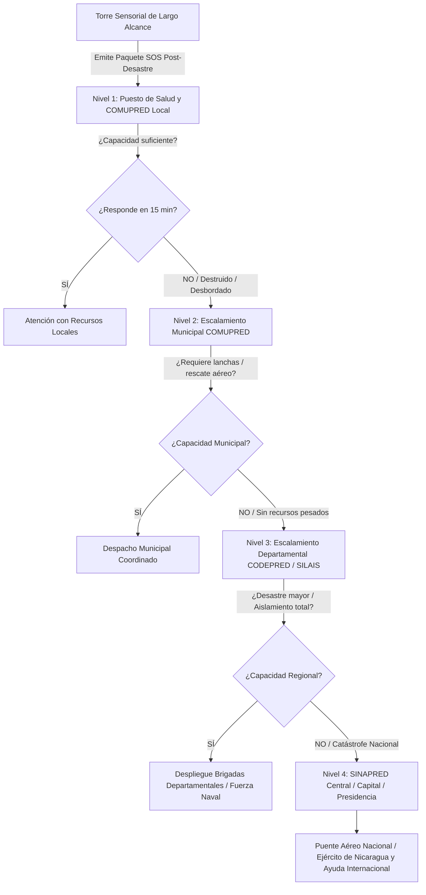

# Sistema Nodal Autónomo de Detección, Gestión de Rescate y Escalamiento Jerárquico en la Post-Emergencia (RESILIX-LATAM)

**Desafío Oficial:** Desafío 9 — Optimización y priorización de recursos y esfuerzos en la post-emergencia  
**Ámbito de Aplicación:** Zonas vulnerables de Latinoamérica (costas, riberas y comunidades aisladas tras el impacto)  
**Disciplina:** Ingeniería en Computación / Sistemas Distribuidos / Cloud & Edge IoT / Inteligencia Artificial  

---

## 1. Resumen Ejecutivo y Enfoque Post-Emergencia

El proyecto se concentra **exclusivamente en la fase de POST-EMERGENCIA** (las primeras 72 horas críticas tras el impacto de una catástrofe natural como huracanes, aludes, sismos o inundaciones severas). En este escenario, las comunidades sufren el colapso total de redes eléctricas y telecomunicaciones, las carreteras quedan anegadas o destruidas y las autoridades enfrentan una avalancha caótica de pedidos de auxilio con información fragmentada.

Para resolver la parálisis en la toma de decisiones, se propone una **Red de Torres Sensoriales Noc-Autónomas de Largo Alcance (15 a 40 km)** integradas a una **Plataforma Cloud Distribuida por Nodos**. 

Inmediatamente tras cesar el evento extremo, la torre realiza un diagnóstico territorial automatizado y genera un **Paquete de Telemetría Crítica SOS Post-Desastre**:
1. **Mapa de calor de sobrevivientes** (visión térmica infrarroja de onda media).
2. **Conteo estimado de personas atrapadas o aisladas** (radar AESA y visión artificial).
3. **Nivel residual de inundación y transitabilidad de vías y puentes**.
4. **Estado operativo de servicios vitales** (inundación de plantas de bombeo de agua potable, corte de alimentadores eléctricos y daños en puestos de salud).

Este paquete se distribuye en paralelo a los organismos competentes (**MINSA, COMUPRED, SINAPRED, ENACAL, ENATREL y MTI**). Si la capacidad de respuesta local se encuentra rebasada o destruida, el sistema activa un **Algoritmo de Escalamiento Jerárquico Automático** (Comunidad ➔ Municipio ➔ Departamento ➔ Capital/Nacional), garantizando el despacho prioritario de ayuda humanitaria hacia donde existe mayor peligro de pérdida de vidas.

---

## 2. El Proceso Operativo en la Post-Emergencia (Las 72 Horas Críticas)

```
 [HORA 0 - 2: Diagnóstico Ciego Territorial]
 ├── La torre activa su barrido de 360° con Radar AESA (18-40 km) y Cámara Térmica Criogénica (16-30 km).
 ├── Recibe telemetría IoT LoRaWAN (hasta 50 km) del estado de plantas de agua, red eléctrica y botones SOS.
 └── Estructura el Paquete de Telemetría SOS Post-Desastre con el cálculo del "Life Threat Score".

 [HORA 2 - 12: Triage y Distribución Multiactor]
 ├── Despacho paralelo de alertas especializadas a Hospitales, CODE, ENACAL, ENATREL y MTI.
 └── Generación automática de rutas de rescate según vías transitables (terrestre 4x4, lanchas o puente aéreo).

 [HORA 12 - 72: Escalamiento Jerárquico y Seguimiento]
 ├── Monitoreo de tiempos de respuesta (SLA de 15 minutos por nivel).
 ├── Escalamiento en cascada: Comunidad ➔ Municipio ➔ Departamento ➔ Capital ante centros locales colapsados.
 └── Verificación en tiempo real del descenso de víctimas térmicas a medida que son evacuadas.
```

---

## 3. Parametrización Interinstitucional Post-Emergencia

Cada dato recolectado por la torre se mapea directamente con los umbrales de decisión de las entidades rectoras en Nicaragua y Latinoamérica:

### A. Salud y Rescate de Sobrevivientes ➔ MINSA & DEFENSA CIVIL / CRUZ ROJA

| Sensor en Torre | Variable Física / Unidad | Umbral Crítico Post-Impacto | Acción Institucional Automatizada |
| :--- | :--- | :---: | :--- |
| **Cámara Térmica MWIR Refrigerada (FLIR Ranger HDC)** | Firmas térmicas corporales ($36.0^\circ\text{C} - 37.5^\circ\text{C}$) | Detección perimetral de personas en techos, agua o laderas aisladas (alcance 10-16 km) | **Defensa Civil / Bomberos:** Despacho de lanchas rápidas Zodiac o cuadrillas de rescate con coordenadas GPS exactas. |
| **Radar AESA Micro-Doppler (Hensoldt SPEXER 2000)** | Conteo y clasificación de siluetas humanas en movimiento | $\ge 1$ personas atrapadas o en riesgo vital | **MINSA / SILAIS Departamental:** Alistamiento previo de camillas de trauma, sueros antiofídicos, frazadas térmicas y médicos de urgencia. |
| **Triage START Algorítmico** | Tiempo de inmovilidad en zona de agua | Inmovilidad $> 45\text{ min}$ en zona inundada | Clasificación automática como **Código Rojo (Prioridad 1 Vital)**. |

### B. Agua Potable y Saneamiento ➔ ENACAL

| Sensor / Telemetría | Variable Monitoreada | Umbral Crítico Post-Impacto | Acción Institucional Automatizada |
| :--- | :--- | :---: | :--- |
| **Sensor de Anegamiento en Caseta de Bombeo** | Nivel de agua en sala de máquinas ($\text{cm}$) | **$> 15\text{ cm}$** de agua en la caseta | **ENACAL:** Orden telemétrica de corte de emergencia al motor de la bomba para **evitar que se queme**, protegiendo el activo para la reconstrucción. |
| **Turbidez y Contaminación de Red** | Turbidez de agua de pozo ($\text{NTU}$) | **$> 100\text{ NTU}$** o contacto con letrinas | **ENACAL:** Cierre de válvulas de red y activación automática de **ruta de camiones cisterna con agua potable** hacia albergues. |

### C. Red Eléctrica y Transmisión ➔ ENATREL & DISNORTE-DISSUR

| Sensor / Telemetría | Variable Monitoreada | Umbral Crítico Post-Impacto | Acción Institucional Automatizada |
| :--- | :--- | :---: | :--- |
| **Inclinómetro en Postes y Sensores de Falla** | Inclinación de postes y cables caídos | **Inclinación $> 15^\circ$** o cortocircuito a tierra | **ENATREL:** Desconexión remota del alimentador rural de media tensión para **evitar la electrocución de personas en zonas anegadas**. |
| **Estado de Subestaciones** | Tensión en circuitos de distribución | Caída a $0\text{ V}$ en zonas anegadas | **ENATREL:** Mapeo SCADA de apagón y priorización de cuadrillas hacia hospitales y pozos de bombeo primero. |

### D. Vías, Puentes y Puertos ➔ MTI & POLICÍA NACIONAL

| Sensor en Torre | Variable Monitoreada | Umbral Crítico Post-Impacto | Acción Institucional Automatizada |
| :--- | :--- | :---: | :--- |
| **Radar de Superficie + Zoom Óptico 40x** | Socavación de estribos y colapso de puentes | Erosión de bases $> 0.8\text{ m}$ o losas caídas | **MTI / Policía:** Cierre inmediato de cruce vehicular y desvío de convoyes humanitarios hacia rutas alternas. |
| **Radar FMCW 80 GHz** | Altura de espejo de agua sobre calzada | **$> 30\text{ cm}$** de agua sobre la vía | **MTI:** Declaratoria de ruta intransitable para vehículos convencionales (habilitada solo para camiones 4x4 pesados y lanchas). |

---

## 4. Estructura del Paquete de Telemetría SOS Post-Desastre (JSON/CAP)

La torre procesa en su computador de borde y transmite vía satélite/microondas el consolidado de la catástrofe:

```json
{
  "node_id": "TORRE-REGIONAL-CARIBE-01",
  "zone": "Cuenca Baja / Haulover - Prinzapolka",
  "timestamp": "2026-10-16T15:00:00Z",
  "phase": "POST_DISASTER_ASSESSMENT",
  "sinapred_alert": "RED_ACTIVE_RESPONSE",
  "telemetry": {
    "water_receding_level_meters": 2.65,
    "thermal_detected_survivors": 24,
    "estimated_trapped_critical": 8,
    "thermal_heatmap_coordinates": [
      {"lat": 13.5214, "lon": -83.5642, "victims": 14, "location": "School_Roof"},
      {"lat": 13.5180, "lon": -83.5598, "victims": 10, "location": "Isolated_Church"}
    ],
    "critical_services_status": {
      "enacal_water_pump": "INOPERATIVE_SHUTDOWN_PROTECTED",
      "enatrel_circuit": "TRIPPED_SAFE_DEENERGIZED",
      "local_health_post": "ISOLATED_STRUCTURAL_DAMAGE",
      "main_bridge": "SCOURED_IMPASSABLE_FOR_TRUCKS",
      "dock_pier": "ACCESSIBLE_FOR_BOATS"
    }
  },
  "computed_life_threat_score": 94.5,
  "recommended_dispatch": {
    "transport_mode": "NAVAL_RIVERINE_BOATS",
    "priority_level": 1,
    "immediate_needs": ["WATER_CISTERNS", "TRAUMA_MEDICS", "ZODIAC_RESCUE"]
  }
}
```

---

## 5. Algoritmo de Escalamiento Jerárquico en Cascada

Resuelve el problema central del Desafío 9: **¿A quién acudir cuando la autoridad o centro de salud local no puede responder?**



* **Regla de Timeout Estricto (15 minutos):** Si la brigada local o puesto de salud no confirma disponibilidad operativa en 15 minutos tras el impacto, el sistema escala automáticamente al nivel **Municipal**.
* **Bypass de Catástrofe Extrema:** Si el índice *Life Threat Score* supera los **85 puntos** (más de 10 personas atrapadas, bomba de agua inundada y puente cortado), la plataforma **activa en simultáneo los niveles Departamental y Nacional** de manera inmediata.

---

## 6. Hardware de Ultra-Largo Alcance (15 a 40 km de Cobertura)

Para cubrir territorios enteros con pocas torres:

1. **Visión Térmica Criogénica MWIR:** **FLIR Ranger HDC ER**
   - Micro-refrigerador Stirling a $-196^\circ\text{C}$ con zoom continuo 22x.
   - Detecta personas a **10–16 km** y lanchas/techos aislados a **20–30 km a la redonda**.
2. **Radar de Superficie Todo-Clima:** **Hensoldt SPEXER 2000 (AESA 3D)**
   - Microondas en Banda X inmunes a lluvia, niebla y humo.
   - Detecta personas a **18 km** y vehículos/lanchas a **22–36 km**.
3. **Pasarela LoRaWAN de Telemetría Comunal:** **RAK7289 V2 WisGate Edge Pro**
   - Conecta hasta 15,000 sensores de bombas de agua (ENACAL), postes (ENATREL) y botones de pánico comunitarios en un radio de **30 a 50 km**.
4. **Enlace Satelital Táctico:** **Starlink Flat High Performance**
   - Transmisión continua resistente a vientos huracanados de más de 280 km/h.
5. **Energía Híbrida Autónoma:** 4 paneles solares bifaciales de 450W + micro-aerogenerador eólico vertical + batería LiFePO4 de 48V (4.8 kWh) con 72 horas de autonomía total.
