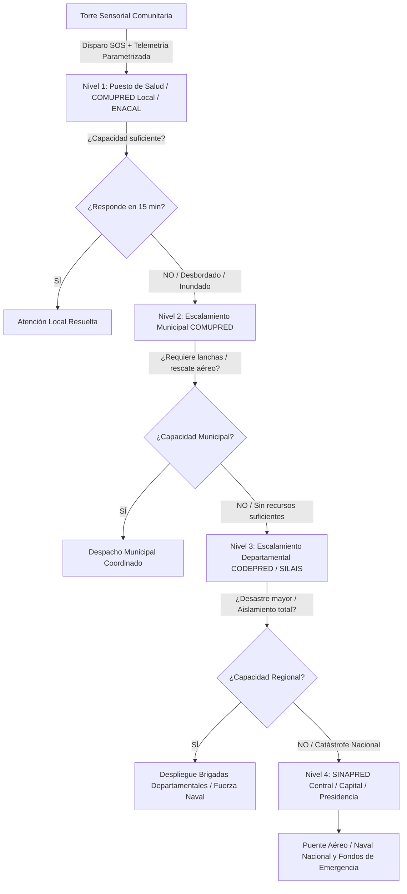

# Sistema Nodal Autónomo de Detección, Gestión de Rescate y Escalamiento Jerárquico Post-Desastre (RESILIX-LATAM)

**Desafío Oficial:** Desafío 9 — Optimización y priorización de recursos y esfuerzos en la post-emergencia  
**Ámbito de Aplicación:** Zonas vulnerables de Latinoamérica (costas, riberas y comunidades aisladas)  
**Disciplina:** Ingeniería en Computación / Sistemas Distribuidos / Cloud & Edge IoT  

---

## 1. Resumen Ejecutivo y Visión

El proyecto propone una **red de torres sensoriales autónomas conectadas a una plataforma cloud distribuida por nodos**, diseñada para operar de forma continua en las tres fases del ciclo del desastre (**Pre, Durante y Post-Emergencia**). 

Al detectar una catástrofe o anomalía extrema, la torre genera un **Paquete de Telemetría Crítica SOS** (mapa de calor de sobrevivientes, estimación de personas atrapadas, nivel de agua/marea y estado de servicios vitales). Este paquete se despacha de inmediato a los actores esenciales (**Hospitales/MINSA, Centros de Operaciones de Emergencia —CODE/COMUPRED/SINAPRED—, Plantas de Bombeo de Agua Potable —ENACAL—, Red Eléctrica —ENATREL— y Transporte —MTI—**). 

Si la capacidad de respuesta local se encuentra colapsada, destruida o desbordada, el sistema activa un **Algoritmo de Escalamiento Jerárquico Automático** que eleva la solicitud en cascada del nivel **Comunitario ➔ Municipal ➔ Departamental ➔ Capital/Nacional**, garantizando que la ayuda llegue sin vacíos de comunicación.

---

## 2. El Ciclo Integral de Monitoreo (Pre, Durante y Post)

```
       PRE-EMERGENCIA                      DURANTE EL IMPACTO                     POST-EMERGENCIA
 ┌─────────────────────────┐           ┌────────────────────────┐           ┌────────────────────────┐
 │ • Nivel de marea / río  │           │ • Monitoreo de anegado │           │ • Mapa de calor (FLIR) │
 │ • Presión barométrica   │   ─────>  │ • Resistencia de torre │   ─────>  │ • Conteo de víctimas   │
 │ • Velocidad del viento  │           │ • Registro de colapsos │           │ • Estado de bombeo     │
 │ • Alerta temprana       │           │ • Transmisión satélite │           │ • Disparo SOS + Triage │
 └─────────────────────────┘           └────────────────────────┘           └────────────────────────┘
```

1. **Fase Pre-Emergencia (Prevención Activa):**
   - Sensores ultrasónicos e hidrostáticos miden en tiempo real el ascenso de mareas o caudales de ríos.
   - La estación meteorológica detecta caídas abruptas de presión barométrica (huracanes) y velocidades críticas de viento.
   - Emite avisos tempranos a la población y a los comités locales de prevención para evacuación preventiva.

2. **Fase Durante la Emergencia (Supervivencia y Registro Ciego):**
   - La torre, construida bajo grado de protección IP67 y alimentada por energía solar con baterías LiFePO4, mantiene su operatividad aunque la red eléctrica y celular comercial colapsen.
   - Registra el avance de la inundación y almacena los datos de impacto en su servidor de borde (*Edge Storage*).

3. **Fase Post-Emergencia (Rescate Inmediato y Telemetría de Supervivencia):**
   - Inicia el barrido térmico perimetral de $360^\circ$ con cámaras LWIR para identificar firmas de calor corporal humano (36°C - 37.5°C).
   - Sensores de presencia mmWave confirman vida en estructuras cubiertas por escombros o follaje.
   - Estructuración del paquete de datos SOS y envío instantáneo al servidor central y actores de auxilio.

---

## 3. Parametrización Interinstitucional de Monitoreo

Para garantizar la interoperabilidad con las instituciones rectoras (SINAPRED, COMUPRED, INETER, MINSA, ENACAL, ENATREL y MTI), los datos captados por la torre se parametrizan según umbrales físicos y niveles oficiales de alerta:

### A. Hidrología y Meteorología ➔ INETER & SINAPRED / COMUPRED

| Sensor en Torre | Variable Física / Unidad | Alerta Verde (Prevención) | Alerta Amarilla (Preparación) | Alerta Roja (Respuesta Inmediata) | Acción Institucional Automatizada |
| :--- | :--- | :---: | :---: | :---: | :--- |
| **Nivel de Agua (Radar / Ultrasónico)** | Cota de río o marea sobre nivel medio ($\text{m}$) | $+1.0\text{ m}$ (subida sostenida) | $+2.0\text{ m}$ (desborde inminente en zonas bajas) | **$> +3.0\text{ m}$** (anegamiento severo en viviendas) | **INETER / COMUPRED:** Notificación automática de evacuación por sectores y cierre preventivo de vados/cruces. |
| **Estación Meteorológica Ultrasónica** | Velocidad de viento y rachas ($\text{km/h}$) | $45 - 62\text{ km/h}$ (tormenta) | $63 - 118\text{ km/h}$ (tormenta tropical fuerte) | **$> 119\text{ km/h}$** (vientos de huracán) | **Fuerza Naval / SINAPRED:** Suspensión de zarpe en puertos marítimos y lagos; aviso de resguardo comunal. |
| **Barómetro Digital de Precisión** | Presión atmosférica ($\text{hPa / mbar}$) | $1005 - 1000\text{ hPa}$ | $999 - 980\text{ hPa}$ | **$< 980\text{ hPa}$** (proximidad del ojo ciclónico) | **INETER:** Cálculo de trayectoria de impacto y tiempo de marea ciclónica. |
| **Pluviómetro Óptico** | Precipitación acumulada ($\text{mm/h}$) | $> 30\text{ mm/h}$ | $> 60\text{ mm/h}$ continuo | **$> 100\text{ mm en 3h}$** | **COMUPRED:** Alerta de deslizamientos de ladera y aludes en zonas montañosas. |

### B. Salud y Rescate Térmico ➔ MINSA & DEFENSA CIVIL / CRUZ ROJA

| Sensor en Torre | Variable Física / Unidad | Clasificación de Gravedad | Umbral de Disparo | Acción Institucional Automatizada |
| :--- | :--- | :---: | :---: | :--- |
| **Cámara Térmica LWIR (FLIR Lepton 3.5)** | Firmas térmicas corporales ($36.0^\circ\text{C} - 37.5^\circ\text{C}$) | Detección perimetral de personas en techos o agua | $\ge 1$ personas detectadas en zona de riesgo | **Defensa Civil / Bomberos:** Despacho de lanchas rápidas Zodiac o brigadas acuáticas con coordenadas georreferenciadas exactas. |
| **Triage START Algorítmico** | Clasificación por inmovilidad o tiempo en agua | 🔴 **Rojo (Crítico)** <br> 🟡 **Amarillo (Grave)** <br> 🟢 **Verde (Leve)** | Si la persona detectada no muestra desplazamiento en $> 45\text{ min}$ en zona inundada | **MINSA / SILAIS Departamental:** Alistamiento de camillas de trauma, sueros antiofídicos, paquetes de hipotermia y médicos de guardia antes del arribo de heridos. |

### C. Agua Potable y Saneamiento ➔ ENACAL

| Sensor en Estación | Variable Física / Unidad | Umbral Crítico | Acción Institucional Automatizada |
| :--- | :--- | :---: | :--- |
| **Sensor de Anegamiento en Caseta** | Nivel de agua en sala de bombeo ($\text{cm}$) | **$> 15\text{ cm}$** | **ENACAL:** Orden telemétrica de corte remoto de energía al tablero para **evitar la quema de los motores de la bomba**. |
| **Sensor de Turbidez Óptica** | Turbidez de agua cruda ($\text{NTU}$) | **$> 100\text{ NTU}$** (colapso de filtros potabilizadores) | **ENACAL:** Cierre de válvulas a la red y activación inmediata de **ruta de camiones cisterna** hacia los albergues. |

### D. Red Eléctrica y Transmisión ➔ ENATREL & DISNORTE-DISSUR

| Sensor / Telemetría | Variable Monitoreada | Umbral Crítico | Acción Institucional Automatizada |
| :--- | :--- | :---: | :--- |
| **Inclinómetro en Torre / Postes** | Inclinación de postes y líneas ($\text{grados } ^\circ$) | **Inclinación $> 15^\circ$** o vibración por caída de árbol | **ENATREL / Distribuidora:** Desconexión automática del alimentador rural de media tensión para evitar electrocuciones masivas en el agua. |
| **Sensor de Tensión y Retorno** | Voltaje de línea ($\text{Voltios}$) | Caída a $0\text{ V}$ o falla a tierra por cables caídos | **ENATREL:** Mapeo de circuitos apagados en SCADA y priorización de cuadrillas hacia hospitales y plantas de agua. |

### E. Vías y Puentes ➔ MTI (Transporte e Infraestructura)

| Sensor en Puente/Vía | Variable Monitoreada | Umbral Crítico | Acción Institucional Automatizada |
| :--- | :--- | :---: | :--- |
| **Sensor de Socavación Ultrasónico** | Erosión de bases de puentes ($\text{m}$) | Erosión de estribos $> 0.8\text{ m}$ | **MTI / Policía Nacional:** Cierre de paso vehicular pesado y desvío de convoyes humanitarios. |
| **Sensor Óptico de Espejo de Agua** | Altura de agua sobre calzada ($\text{cm}$) | **$> 30\text{ cm}$** de agua sobre la vía | **MTI:** Declaratoria de vía intransitable para vehículos ligeros (acceso exclusivo para 4x4 pesados y lanchas). |

---

## 4. El Paquete de Telemetría SOS (JSON/CAP)

La torre emite una estructura de datos estándar y ligera (menor a 2 KB) procesable por cualquier sistema:

```json
{
  "node_id": "TORRE-CARIBE-04",
  "community": "Haulover / Prinzapolka",
  "timestamp": "2026-10-16T14:02:10Z",
  "sinapred_alert_level": "RED_ACTIVE_EMERGENCY",
  "metrics": {
    "water_level_meters": 2.85,
    "flood_trend": "RISING",
    "wind_speed_kmh": 128.4,
    "barometric_pressure_hpa": 974.2,
    "thermal_human_count": 18,
    "estimated_trapped_persons": 6,
    "critical_infrastructure": {
      "enacal_water_pump": "FLOODED_SHUTDOWN_TRIGGERED",
      "enatrel_circuit_status": "TRIPPED_SAFE",
      "local_health_post": "ROOF_COLLAPSED",
      "main_dock_pier": "ACCESSIBLE_FOR_BOATS"
    }
  },
  "calculated_priority": "LEVEL_1_EXTREME",
  "thermal_heatmap_uri": "s3://resilix-latam/heatmaps/tc04_20261016.png"
}
```

---

## 5. Algoritmo de Escalamiento Jerárquico en Cascada

Este es el mecanismo diseñado para **evitar el abandono de comunidades** cuando el centro de auxilio local queda inoperativo:



* **Regla de Timeout Automático (SLA de 15 minutos):** Si el centro local no confirma recepción y disponibilidad de personal en 15 minutos, la plataforma escala automáticamente al nivel superior con advertencia: *"Nivel Local Inoperativo - Requiere Intervención Municipal Urgente"*.
* **Bypass de Emergencia Extrema:** Si los sensores registran simultáneamente Nivel de Agua en Alerta Roja ($> 3.0\text{ m}$), más de 10 personas atrapadas y la estación de ENACAL anegada, el sistema **activa simultáneamente los niveles Municipal y Departamental sin esperar timeouts**.

---

## 6. Viabilidad, Factibilidad e Impacto Social

1. **Viabilidad Técnica:** Protocolo abierto JSON sobre WebSockets, compatibilidad con SCADA de ENATREL/ENACAL y el protocolo internacional de emergencias CAP.
2. **Factibilidad Operativa:** Se adapta a la estructura legal y operativa de la Ley 337 de Nicaragua (Creadora del SINAPRED) y sus homólogos en Centroamérica y Sudamérica.
3. **Impacto Humanitario:** Transforma una respuesta lenta de días en un **despliegue coordinado en menos de 30 minutos**, articulando salud, agua potable, energía y rescate en una sola visión integral.
